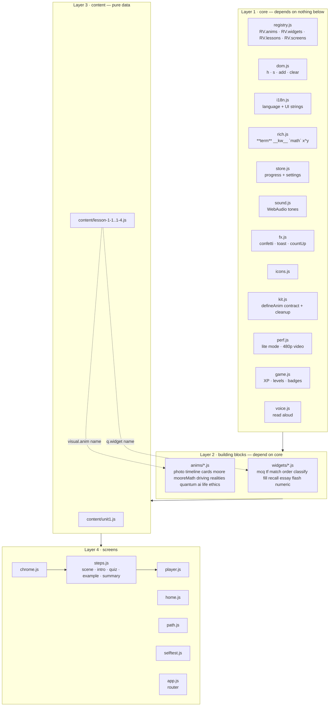

# Architecture — module graph

Plain HTML + CSS + classic `<script>` files (no build step, no framework), so it runs from any static host,
offline, and on iPad/iPhone Safari. Every module owns **one** responsibility and talks to others only through
the registries in `js/core/registry.js`.



### Rules
1. **Content never contains code.** A lesson file only names things: `visual: { anim: 'edgeVsCloud' }`, `q: { widget: 'mcq', ... }`.
2. **Anims are self-contained.** Each one is `RV.kit.defineAnim(name, (stage, props, api) => ({ beat(i) }))`.
   The kit kills every tween/timer/listener when the step changes — anims never clean up by hand.
3. **Widgets report, the player decides.** A widget calls `ctx.onAnswer({ correct, score, max })`; scoring/navigation live in `player.js`.
4. **All numbers in animations are computed** (Moore solver, car physics) and unit-tested in `tests/run.js`.
5. Bilingual everywhere: every text is `{ ar, en }`; the test fails if one side is missing.
6. Never use CSS `translate:` on elements GSAP transforms; never pass maybe-null children to native `.append()` (use `RV.dom.add`). Both are linted.

---

## Editing content (no programming needed)

Everything a student reads is in `js/content/lesson-*.js`.

```js
{ type: 'scene',
  title: { ar: '…', en: '…' },
  visual: { anim: 'nestedCircles' },          // which animation (see list below)
  beats: [ { ar: '…', en: '…' }, … ],          // one line per tap; the anim gets beat(i)
  notes: [ { kind: 'exam' | 'confuse' | 'tip' | 'think', text: { ar, en } } ] }
```
Inline markup: `**key term**`, `__keyword__`, `` `formula` `` (stays LTR inside Arabic), `2^11.5` → superscript.

Question widgets (`{ type: 'quiz', q: {...} }`):

| widget | fields |
|---|---|
| `mcq` | `prompt, options[], answer: i` or `answer: [i, j]` (multi-select) |
| `tf` | `items: [{ text, answer: true/false, explain? }]` |
| `match` | `prompt, left[], right[], answer: [rightIndex per left]` |
| `order` | `prompt, items[]` (in the correct order — shuffled on screen) |
| `classify` | `prompt, groups: [{ label, icon }], items: [{ text, group }]` |
| `fill` | `prompt, text: { ar: '… {0} … {1}', en }, bank[], answer: [bankIndex per blank]` |
| `numeric` | `prompt, answer, tolerance?, unit?, hint?, check?: { mode, y0, n0, y1 }` (check = verified against the Moore formula by tests) |
| `recall` | `prompt, items: [{ q, a }]` (say it → reveal → self-mark) |
| `essay` | `prompt, marks?, points[] (checklist), model` |
| `flash` | `cards: [{ front, back }]` |
| `poll` | `prompt, options: [{ emoji, text }], after?` — predict-first, no right/wrong |
| `speed` | `id, seconds?, items: [{ text, answer: bool }]` — 60 s true/false game |
| `guess` | `prompt, y0, n0, y1` — log-slider Moore guessing game |

A worked example is `{ type: 'example', q: {...}, solution: [ {ar,en}, … ] }`.

### A new Moore's-law example = data only
```js
visual: { anim: 'mooreSolver', props: { mode: 'forward', y0: 2002, n0: 1451, y1: 2025 } }
// modes: forward {y0,n0,y1} · backward {y1,n1,y0} · years {ratio}
```
The board lines, doubling ladder, bars and the final count-up are all computed.

### Adding a lesson
1. Copy `js/content/lesson-1-4.js` → `lesson-X-Y.js`, change `id`, texts, `color`, `cover`.
2. Add the id to `RV.unit.lessons` in `js/content/unit1.js` and a `<script>` tag in `index.html`.
3. `node tools/fix-math-markup.js js/content/lesson-X-Y.js --write` (isolates formulas in Arabic text).
4. `node tests/run.js` → must be ✅. Then `node tools/build.js`.

## Animations available
One explanation per topic (duplicates were removed on 2026-10-12):
- **Teacher-driven movies** (`js/anims/movie-kit.js`, 1920×880 board, one scene per beat, ⟲ replay): `eraMovie` `mooreMovie` `societyMovie` · `aiMovie` `learnMovie` `dlMovie` `genaiMovie` (own look: `css/anims-movies-l12.css`) · `aiLifeMovie` `cautionMovie` · `biasMovie` `privacyMovie` `xaiMovie` `principlesMovie` · `httpsMovie` `mfaMovie` `networkMovie` `incidentMovie`. `props: { scenes: [first, last] }` shows part of a movie (e.g. `aiLifeMovie` 0–2 in *daily*, 3–5 in *industry*).
- **Topic visuals**: `hero` `photo` (`credit` for licensed photos) · `mooreFormula` `mooreSolver` `mooreLab` `mooreSymbols` · `selfDriving` `edgeVsCloud` · `arVr` · `bitQubit` · `commonKey` `keyPair` `signCert` `securityStack` · `defenseDepth` `zeroTrust` · `incidentTypes` `riskMatrix`.
- `tools/prune-steps.js` removes scene steps by rule (dry run by default).

## Quality gates
| command | checks |
|---|---|
| `node tests/run.js` | every script loads · no orphan files · lessons/stations/steps valid · every widget's own `validate()` · bilingual completeness · images exist · Moore solver & car physics numbers · numeric answers match the formula · lint rules · `sw.js` fresh |
| `#/selftest` (browser) | mounts every step of every lesson in both languages, plays all beats, reveals every answer — reports any exception |
| `?drive` (URL flag) | ticks GSAP on a timer — only for embedded preview panes that pause `requestAnimationFrame` |

## Layout safety net (nothing cut off, ever)
- `anims/photo.js` fits the whole picture (contain + blurred backdrop); hotspot `x/y` are % of the image itself.
- `api.fitBox(box, inner)` shrinks a text-heavy panel to fit (board, spam trainer, bias sim, hallucination).
- `kit.autoFit` runs automatically for every anim (mount, each beat, resize): any absolutely-positioned HTML layer whose in-flow content is bigger than the stage is laid out larger and scaled down with CSS `scale`.
- `gsap.from` / `timeline.from` are guarded: previous finite tweens on the same targets are finished first, so fast tapping never leaves text half-transparent. `api.after` timers started by a beat are flushed when the next beat starts.
- QA: `#/audit` (all visuals) and `#/audit/<lesson>/<station>/<step>/<beat>` (one step, frozen). Run at 1180×820, 820×1180 and 390×844; result in `window.__audit`.
- Motion level is the user's choice (✨ in the top bar → setting `calm`); the OS "reduce motion" flag is not used because animation is the lesson itself.
